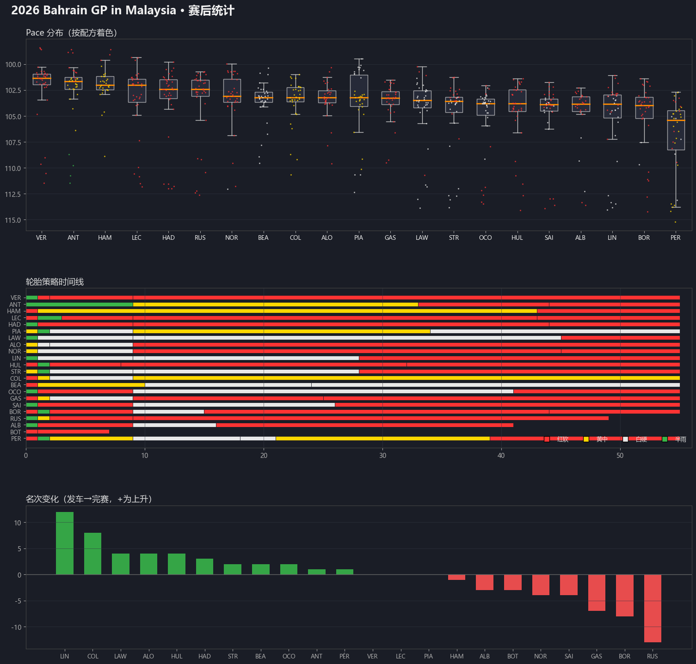
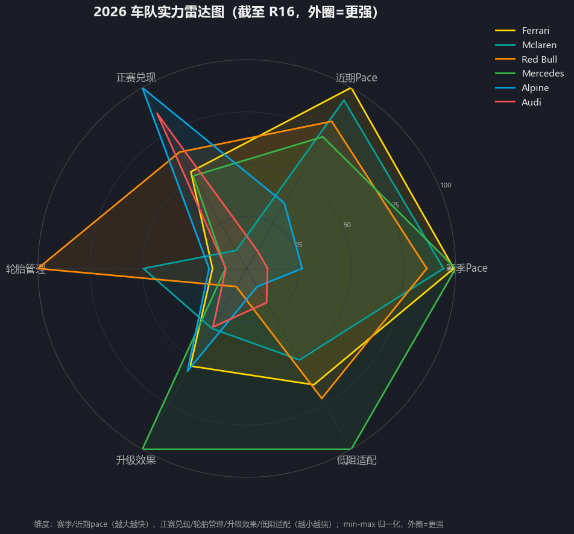
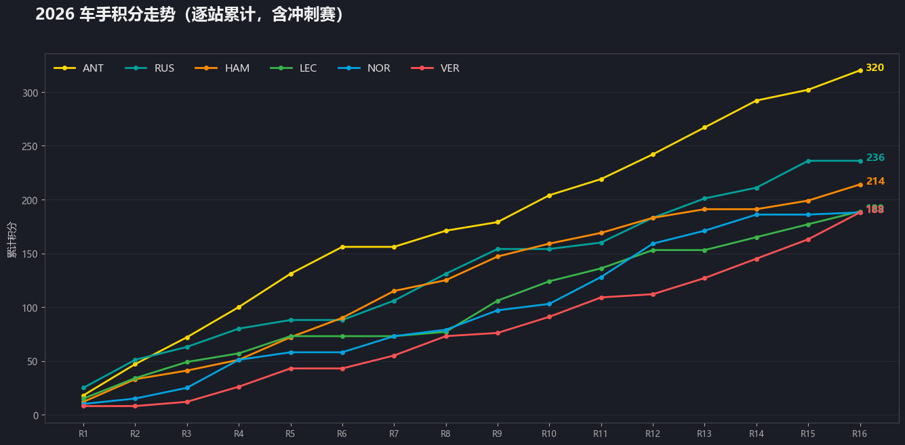
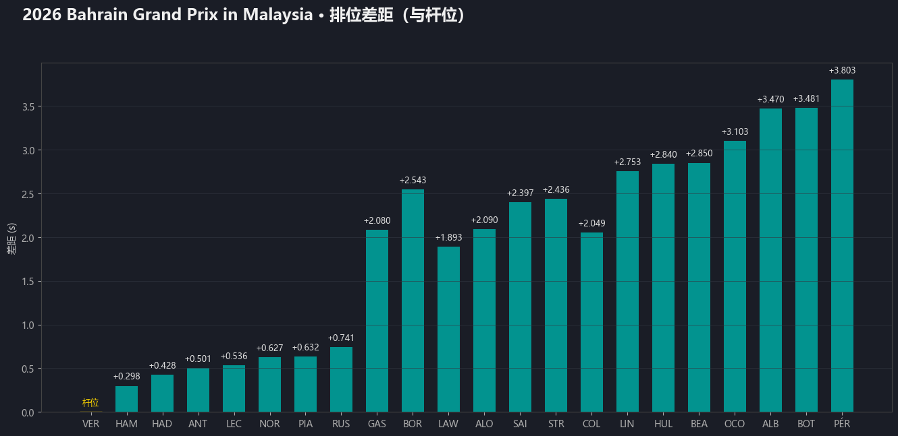
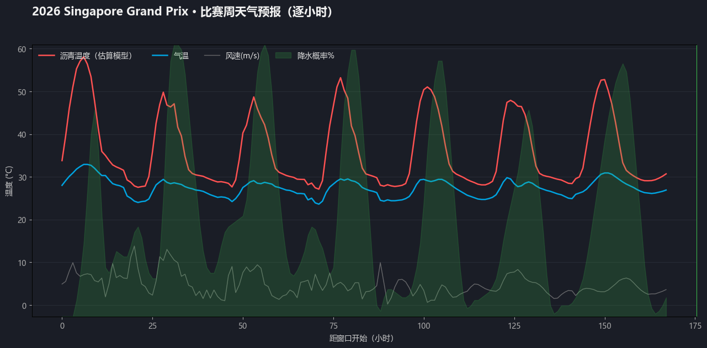
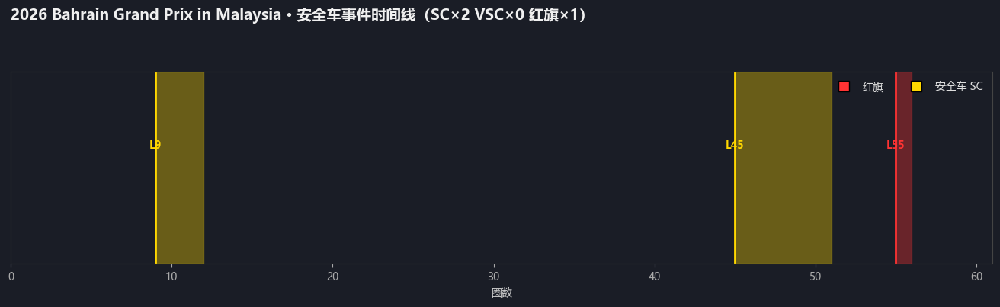
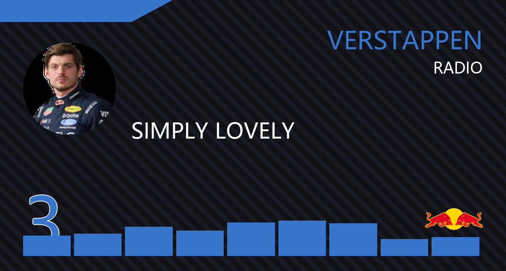

# F1 Schedule Reminder Bot

[中文文档](README.md) | **English**

An F1 assistant bot for QQ group chats (and **Discord** — see below). Built on the official QQ Bot API V2 — no third-party frameworks, stable and compliant.

Once invited to your group, it:

- **Pushes automatically**: reminders before practice/qualifying/sprint/race (dual timezones, circuit weather), full results and updated standings after the race, F1 news digests twice a day
- **Answers commands**: schedules, standings, historical GP results, upgrade packages, power unit usage, race predictions…
- **AI Q&A**: mention it (@bot) and ask anything about F1 — it queries real data before answering, with web verification, multi-turn follow-ups and image understanding; Bilibili F1 video links get auto-summarized
- **Three-tier decaying memory**: conversations behave like human memory — recent turns stay crisp, old ones fade into topic summaries, key facts stay anchored forever. Unrelated history never leaks into a new topic. `/clear` archives (doesn't delete); `/memory` shows what it remembers
- **Driver rating**: after each race the group gets a voting link → driver rating board + season DOTD chart
- **Live timing panel**: web-based live timing during race weekends (positions/gaps/tyres/team radio)
- **Stat charts**: post-race triple chart (pace distribution / tyre strategy / position changes), quali gap chart, safety-car timeline, points trend, pit-stop comparison, PU usage, crash costs…
- **Ops-friendly**: admins can hot-swap AI providers/keys/models from DM (`/llm`) — including local models via Ollama; secrets are auto-redacted from all outbound messages and logs

> 🌐 **Discord version available** (recommended for international users): full feature parity — scheduled pushes, 31 slash commands, charts uploaded directly (no public domain needed), `/ask` AI Q&A, bilingual UI (en/zh). See [discord_version/README.md](discord_version/README.md).

## Screenshots

| Post-race triple chart | Team strength radar |
|---|---|
|  |  |

| Driver points trend | Quali gaps |
|---|---|
|  |  |

| Weather timeline (forecast) | Safety-car timeline |
|---|---|
|  |  |

| Team Radio card DIY (`/tr driver quote`) |
|---|
|  |

## Quick Deploy (QQ version)

### Prerequisites

| Item | Notes |
|---|---|
| QQ bot | Register at [QQ Open Platform](https://q.qq.com) (individual developers OK) |
| Server | A Linux server with public IP, Docker + docker compose plugin |
| Domain | Pointed at your server (QQ requires HTTPS callbacks) |

Just want to try locally? Jump to [Run locally](#run-locally-without-docker).

### Step 1: Get four things from the QQ platform

In your bot's console at q.qq.com:

1. **Developer settings** → note `AppID` and `AppSecret`
2. **Developer settings** → verification key → note `BOT_WEBHOOK_SECRET`
3. Invite the bot to your QQ group → Group settings → Bot management → **enable "allow proactive messages"** (scheduled pushes won't send without it)
4. `group_openid` is obtained after deployment (step 3)

### Step 2: Deploy

```bash
git clone https://github.com/EonloveL/F1ScheduleReminder.git
cd F1ScheduleReminder/deploy

cp .env.example .env           # edit: AppID / AppSecret / webhook secret
cp Caddyfile.example Caddyfile # edit: replace your-domain.example.com with your domain
                               # and set RATING_BASE_URL in .env to https://your-domain

chmod +x deploy.sh && ./deploy.sh
```

`deploy.sh` pre-checks config, then brings up 4 containers:

| Container | Role |
|---|---|
| f1-qqbot | Bot main process (pushes + commands + AI Q&A + webhook receiver) |
| f1-qqbot-web | Rating web pages |
| f1-qqbot-live | Live timing panel |
| f1-caddy | HTTPS reverse proxy with automatic Let's Encrypt certificates |

### Step 3: Wire the callback + get group_openid

1. QQ platform → Feature config → message push URL: `https://your-domain/bot/callback`
2. Get the group `group_openid`: temporarily set `USE_SANDBOX=true` in `.env`, `docker compose restart f1-qqbot`, then @ the bot in the group and watch logs:

```bash
docker compose logs -f f1-qqbot
```

or run `python get_group_openid.py` locally. Put it into `QQ_GROUP_OPENID`, set `USE_SANDBOX=false`, restart:

```bash
docker compose up -d
```

When the log shows the bot online and the group receives the startup card — done.

## Usage

### Group commands (excerpt — `/help` in chat for the full list)

| Command | Description |
|---|---|
| `/next` | Next race weekend schedule (dual timezone) |
| `/calendar` | Full season calendar |
| `/drivers` `/teams` | Driver / constructor standings |
| `/last [session]` | Latest results (fp1/fp2/fp3/qualy/sprint/race) |
| `/gp monza 2022 race` | Historical GP results |
| `/predict monza` | Quali/race prediction (statistical model) |
| `/pace monza` | Race pace distribution chart |
| `/racechart` | Post-race triple chart (pace + strategy + positions) |
| `/trend` | Season points trend chart |
| `/pitstops` | Pit-stop duration comparison |
| `/upgrades ferrari monza` | Upgrade packages (FIA official docs) |
| `/pu verstappen 2023` | Power unit component usage |
| `/rate` | Get this race's rating link (vote after the race) |
| `/ratings` `/dotd` | Rating board / season DOTD board |
| `/watch` | Where to watch |
| `/live` | Live timing panel (race weekends) |
| `/setdriver verstappen` | Follow a driver — DM push of their results |
| `/news on` | Subscribe to targeted news DMs for your favourites |
| `/tr driver quote` | Team Radio broadcast-style card DIY |
| `/memory` | Inspect/manage your conversation memory (`/memory forget <id>`) |
| `/clear` | Archive this session (LLM-summarized into long-term memory, not deleted) |

### AI Q&A

Mention the bot and ask:

```
@bot What are the DRS usage rules?
@bot How many wins does Verstappen have this season?
@bot Analyze Ferrari's stint pace from the last race
```

It calls 21 F1 data tools for real data before answering, supports vision and multi-turn follow-ups. Memory is three-tier decaying: recent turns kept verbatim, timed-out sessions archived as topic summaries, important facts anchored permanently — topic switches never get contaminated by stale context. `/clear` archives the session; `/memory` shows what's remembered. Requires an LLM key (see below). On beefy servers you can plug in local models via Ollama (`LOCAL_LLM_MODEL`, or admin `/llm setmodel local <model>`).

## Configuration

Only 4 required entries in `.env`; everything else is optional:

| Key | Required | Notes |
|---|---|---|
| `QQ_APPID` / `QQ_APP_SECRET` | ✅ | QQ Open Platform → developer settings |
| `QQ_GROUP_OPENID` | ✅ | Group ID — see deploy step 3 |
| `BOT_WEBHOOK_SECRET` | ✅ | QQ platform → verification key (webhook signature) |
| `MOONSHOT_API_KEY` / `DEEPSEEK_API_KEY` | Optional | AI Q&A (Kimi / DeepSeek) — without these, @bot has no AI replies |
| `TAVILY_API_KEY` / `BOCHA_API_KEY` | Optional | Web-search enhancement |
| `ADMIN_OPENIDS` | Optional | Admin openids (`/kb` knowledge review, DM `/llm` runtime AI config, `/model` layered models) |
| `OPENF1_USERNAME` / `OPENF1_PASSWORD` | Optional | OpenF1 sponsor account (only needed for live-session scenarios — see below) |

Full config reference: [deploy/.env.example](deploy/.env.example) · LLM wiring guide: [docs/LLM_GUIDE_EN.md](docs/LLM_GUIDE_EN.md) · Admin guide: [docs/ADMIN_GUIDE_EN.md](docs/ADMIN_GUIDE_EN.md)

## Run locally (without Docker)

```bash
pip install -r requirements.txt
cp .env.example .env   # fill in config

python main.py                # bot (:8090 webhook)
python web/rating_server.py   # rating web (:8080)
python web/live_server.py     # live panel (:8091)
```

Without a public HTTPS callback, commands still work over the WebSocket channel; the webhook is only needed for server deployment.

## FAQ

**No scheduled pushes in the group?**
Group settings → Bot management → enable "allow proactive messages" (off by default for newly-added bots).

**@bot doesn't respond / says AI not configured?**
No LLM key in `.env`. Set `MOONSHOT_API_KEY` or `DEEPSEEK_API_KEY` and restart.

**Caddyfile changes not taking effect?**
`docker compose restart f1-caddy` (bind-mounted content changes aren't detected by compose).

**Slow builds / whisper model download fails on mainland-China servers?**
The Dockerfile has commented Aliyun mirror lines — uncomment them; in `deploy/.env.example` uncomment `HF_ENDPOINT=https://hf-mirror.com`.

More deploy details: [deploy/README.md](deploy/README.md).

## Data sources

| Data | Source |
|---|---|
| Schedule / results / standings | f1api.dev (primary) · Jolpica (fallback) |
| Live weather / radio / lap times | OpenF1 |
| Weather forecast / archive | Open-Meteo |
| Upgrades / PU usage | FIA official documents (PDF parsing) · F1Cosmos |
| News aggregation | F1Cosmos |
| LLM | Kimi (Moonshot) · DeepSeek · OpenRouter · Gemini · local (Ollama) |

### OpenF1 lockdown windows and chart coloring

OpenF1 returns 401 to unauthenticated users **during live session windows** (around each session on race weekends); it's free the rest of the time. The chart pipeline is designed around this — **full features with zero config**:

- **Post-race charts** (triple report / SC timeline) are generated after the race — naturally outside the lockdown window, with full tyre-compound coloring at zero cost
- Charts generated inside the window fall back to Jolpica (grey, no compound coloring); once OpenF1 recovers they're regenerated in full color (fallback files carry an `_fb` date-stamp so they never shadow the final versions)
- You only need an OpenF1 sponsor subscription for **live, in-session** colored charts (live panel scenario): set `OPENF1_USERNAME` / `OPENF1_PASSWORD` in `.env` (token auto-refreshes hourly, cooldown on failure)

Run with zero config first — if the first post-race pushes look right, you don't need the subscription.

## Project structure

```
├── main.py              # QQ bot entry (commands / AI wiring)
├── discord_version/     # Discord version (international users, py-cord slash commands, standalone deployable)
├── common/              # Shared library (API wrappers / LLM / three-tier memory / tools / charts / storage)
│   ├── llm/             # LLM engine package (providers / engine / layered / vision)
│   └── prompts/         # LLM prompts (external, editable)
├── web/                 # Rating web + live panel + bundled avatars/team icons
├── deploy/              # QQ Docker one-command deploy (compose / Caddy / scripts)
├── analysis/            # Dev tools: prediction model backtest & calibration (not needed for deployment)
└── data/                # Bundled reference data (driver profiles / circuits / prediction weights)
```

- Python 3.8+, all secrets and IDs via environment variables — no private data in the repo
- Runtime data (user prefs, ratings, conversation memory, caches) goes to `data/`, gitignored

## Changelog

See [CHANGELOG.md](CHANGELOG.md) (appended on every push, user-readable categorized entries).

## Acknowledgements

- The TR card (`/tr`) broadcast visual spec references [wertewrt/F1_team_radio](https://github.com/wertewrt/F1_team_radio) (329:176 card layout / team colors / nine-block waveform); the static image version is this project's own PIL implementation
- Data sources: f1api.dev · Jolpica (Ergast-compatible) · OpenF1 · Open-Meteo · FIA official documents · F1Cosmos

## License

[MIT](LICENSE)
